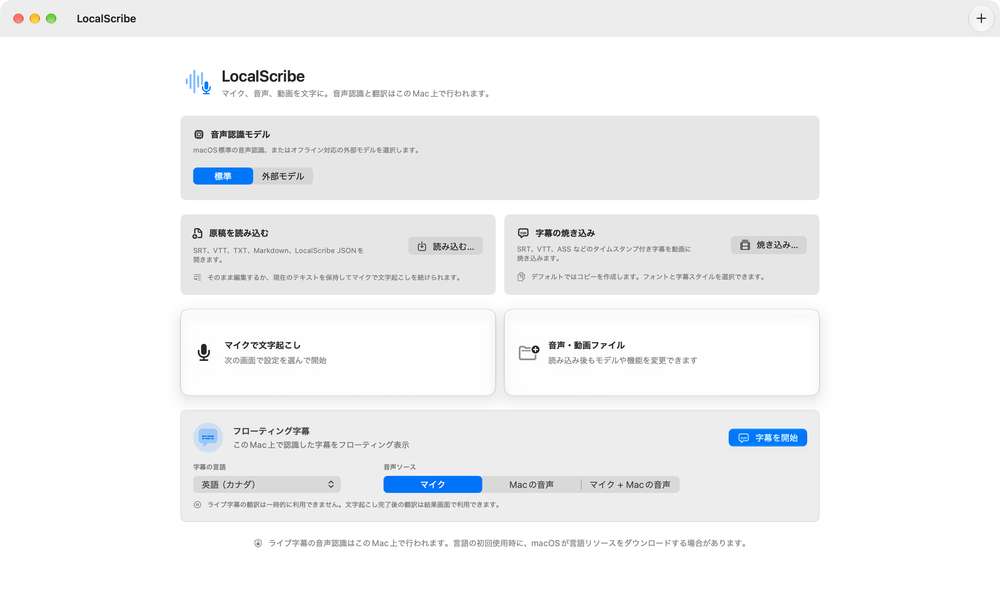

# LocalScribe

[英語](README.md) | [簡体字中国語](README.zh-CN.md) | **日本語**

[](https://support.apple.com/macos)
[](https://support.apple.com/guide/mac-help/about-this-mac-mchl3a2c2cb0/mac)
[](LICENSE)
[](https://github.com/maddylaneeee/ShengJi/actions/workflows/ci.yml)
[](https://github.com/maddylaneeee/ShengJi/releases/latest/download/LocalScribe-macOS-arm64.dmg)

**マイクの音声、音声・動画ファイル、Macで再生中の音を、そのMac上で編集可能なテキストと字幕に。**

LocalScribeは、Appleシリコン搭載Mac向けの無料・オープンソースのSwiftUIネイティブ文字起こしアプリです。アカウント登録は不要です。ローカル音声認識、フローティング字幕、原稿の編集、字幕の書き出しと焼き込み、オフライン翻訳、長時間タスクの復元、本機でのGemma 4による文章の整理をまとめています。認識用の音声はMacの外に出ません。クラウドサービスを選ばない限り、AIも本機で動作します。

現在のリリース：**1.8.1（44）** · [リリースノート（英語）](https://github.com/maddylaneeee/ShengJi/releases) · [DMGをダウンロード](https://github.com/maddylaneeee/ShengJi/releases/latest/download/LocalScribe-macOS-arm64.dmg) · [ユーザードキュメント](https://lixinchen.ca/docs/localscribe/)

<picture>
  <source media="(prefers-color-scheme: dark)" srcset="Documentation/MediaKit/localscribe-demo-ja-dark.gif">
  
</picture>

> [!IMPORTANT]
> アプリはmacOS 15.5以降に対応していますが、**Apple Speechによる音声認識とフローティング字幕にはmacOS 26が必要です**。macOS 15.5–25では、ホーム画面でWhisper、SenseVoice、Parakeetのいずれかを選択してください。

## ダウンロードとインストール

1. [最新のDMGをダウンロード](https://github.com/maddylaneeee/ShengJi/releases/latest/download/LocalScribe-macOS-arm64.dmg)します。
2. DMGを開き、LocalScribeを「アプリケーション」にドラッグします。
3. 一度アプリを開きます。macOSにブロックされた場合は「システム設定」→「プライバシーとセキュリティ」でLocalScribeの「このまま開く」を選び、確認します。

詳しくは[初回起動ガイド（英語）](INSTALL.md)（「このまま開く」が表示されない場合を含む）と、画像付き手順とSHA-256の確認方法を記載した[ダウンロードとインストールガイド（英語）](Documentation/DOWNLOAD.md)をご覧ください。

> [!WARNING]
> 公開パッケージはアドホック署名のみで、Developer ID署名もAppleの公証も受けていません。このリポジトリを信頼できる場合のみ警告を解除してください。各リリースにはSHA-256ファイルが付属します。

## 主な機能

- **3種類の入力。** マイク（システム標準または指定した入力デバイス）、音声・動画ファイル、Macで再生中の音を文字起こしできます。
- **フローティング字幕**（macOS 26）。マイク、Macの音声、または両方を混ぜた入力に対応します。
- **4つのオフライン認識エンジン。** Apple Speech、Metal対応whisper.cpp、SenseVoice、NVIDIA Parakeet。モデルは選択時にのみダウンロードします。
- **原稿の編集。** 検索、置換、選択範囲の削除、範囲指定での切り詰め。長い原稿も滑らかにスクロールできます。
- **読み込みと続き。** SRT、WebVTT、TXT、Markdown、LocalScribe JSONを開いて編集したり、末尾にマイクの文字起こしを追加したりできます。
- **書き出し。** TXT、Markdown、JSON、PDF、SRT、WebVTT、クリップボード。
- **文字起こし後の翻訳。** Apple翻訳、または任意のローカルNLLB。
- **AIによる文章の整理。** 本機のGemma 4、またはLM Studio、OpenAI、DeepSeekのカスタムサービスで校正・推敲・要約できます。
- **動画への字幕の焼き込み。** フォントとスタイルを指定できます。
- **マイクの元音声を保存**し、原稿と一緒にM4Aで書き出せます。
- **長時間タスクの保護。** 段階的な結果表示、一時停止と再開、追記式の記録、中断後の復元。
- **コマンドライン**からモデル管理、文字起こし、翻訳、字幕の焼き込みを実行できます。
- **英語・簡体字中国語・日本語のインターフェイス。** 標準でmacOSの言語に従い、設定で言語と外観（システム／ライト／ダーク）をすぐに切り替えられます。

<picture>
  <source media="(prefers-color-scheme: dark)" srcset="Documentation/Screenshots/home-ja-dark.png">
  
</picture>

<picture>
  <source media="(prefers-color-scheme: dark)" srcset="Documentation/Screenshots/transcript-editor-ja-dark.png">
  
</picture>

## 音声認識・翻訳エンジン

**macOSのバージョンと言語が対応している場合は、Appleの標準エンジンを優先してください。** 品質はサードパーティ製モデルより明らかに優れています。

| エンジン | 用途 | 実行環境 |
| --- | --- | --- |
| Apple Speech | マイク、ファイル、ライブ字幕（macOS 26） | SpeechAnalyzer / SpeechTranscriber |
| Whisper | マイク、ファイル | whisper.cpp GGML、Metal、CPUへのフォールバック |
| SenseVoice | ファイル | sherpa-onnx、利用可能な場合はCore ML、CPUへのフォールバック |
| NVIDIA Parakeet | ファイル | sherpa-onnx、利用可能な場合はCore ML、CPUへのフォールバック |
| Apple翻訳 | 標準の文字起こし後翻訳 | macOS Translationフレームワーク |
| NLLB | 任意の文字起こし後翻訳 | CTranslate2 CPU/int8 |
| Gemma 4 | 校正・推敲・要約 | llama.cppとMetalによるオンデバイス推論 |

Whisperは長い素材で同梱のSilero VADを使って無音区間をスキップし、無音、低信頼度、繰り返し、既知のハルシネーションを含む出力を除外します。

**詳細設定。** サードパーティ製エンジンでは、右側のインスペクタで折りたたまれた「詳細設定」に、各ランタイムが対応する項目のみ表示します。Whisperではプロンプト、温度と再試行、ビームサーチまたは貪欲法、コンテキスト長、無音と信頼度のフィルタ、VAD、スレッド数を調整できます。最後に使ったエンジン、モデル、設定は記憶され、「モデルの標準設定に戻す」は選択中のエンジンのみをリセットします。

## AIによる文章の整理

文字起こしの完了後、または原稿の読み込み後に、右側のインスペクタで「AIで文章を整える」を開きます。

- **校正と推敲：** つなぎ言葉、繰り返し、明らかな認識ミスを修正し、差分をリアルタイムに表示します。検証に失敗したセグメントは原文を保持します。
- **要約：** プレビューを要約に置き換え、取り消し用のスナップショットを保持します。
- 人名、用語、文体、長さ、重点、形式などの指示を一時的に、または保存して使えます。AIの出力は必ず確認してください。

**内蔵Gemma 4。** 標準のE2Bモデルは約2.8 GBで、設定で約4.6 GBのE4Bモデルも有効にできます。モデルは必要時にダウンロードし、AIタスクを選んだときだけ読み込みます。読み込み前に音声認識とNLLBのランタイムを解放します。メモリ8 GB以下のMacでは標準で無効ですが、設定で有効にできます。

**カスタムAIサービス。** 「設定 → モデル → カスタム AI サービスを使用」で、LM Studio（ループバックアドレスのみ、標準は`http://127.0.0.1:1234/v1`）、OpenAI、DeepSeekに接続できます。有効にするとGemmaのダウンロードと読み込みを中止・禁止し、自動ではGemmaに戻りません。OpenAIとDeepSeekはプレビューで、同意後にのみタスクの文章を送信します。API利用には料金が発生する場合があります。[設定ガイド（英語）](Documentation/AI-SERVICES.md)をご覧ください。

## 動画への字幕の焼き込み

ホーム画面の「字幕の焼き込み」、または「ファイル → 字幕を焼き込む…」（⇧⌘B）を選びます。動画（MP4、MOV、M4VなどmacOSで再生できる形式）と字幕ファイル（SRT、WebVTT、LocalScribe JSON、ASS/SSA、SBV、TTML/DFXP）を選ぶか、ドラッグします。有効なタイムスタンプがないファイルは非対応と表示します。ASSのスタイルとTTMLの領域は無視します。

動画の文字起こし後は、「文字起こしを書き出す」の隣の「動画に焼き込む」で、表示中の原文または訳文を使って同じ画面を開けます。

- **出力：** 「コピーを作成」（既定）または「元の動画に直接焼き込む」。後者は新しいファイルの描画と検証が成功した後にのみ元のファイルを置き換えます。
- **スタイル：** インストール済みの任意のフォント、サイズ、上部または下部の位置と余白、任意の背景、調整可能な影。ライブプレビュー付きで、スタイルは記憶されます。
- AVFoundationで描画し、元の解像度と向きを保持します。HEVCの動画はHEVC、その他はH.264で再エンコードします。

## マイクの元音声を保存

新しいマイク文字起こしを始める前に「元の音声を保存」をオンにし、「容量優先」「品質優先」「最高品質」（M4A、AACまたはALAC）から選びます。完了後は0.5×、1×、2×で再生でき、原稿と同じファイル名で書き出せます。原稿を編集・翻訳しても音声は変わりません。ファイルの文字起こし、Macの音声、ライブ字幕、読み込んだ原稿への追記では利用できません。

## キーボードショートカット

| ショートカット | 操作 |
| --- | --- |
| ⌘N | マイクで文字起こし |
| ⌘O | ファイルから文字起こし |
| ⇧⌘O | 原稿を読み込む |
| ⇧⌘B | 字幕を焼き込む |
| Return | 文字起こしを開始 |
| Space | 一時停止／再開 |
| ⌘E | 文字起こしを書き出す |

## 動作環境と制限

- macOS 15.5以降、Appleシリコン（`arm64`）。Intel Macには対応していません。
- Apple Speechの音声認識とライブ字幕にはmacOS 26が必要です。
- SenseVoiceとParakeetはファイルの文字起こしのみ対応しています。
- ライブ字幕の翻訳は現在無効です。文字起こし後の翻訳は利用できます。
- ローカルNLLB翻訳には4 GB以上のメモリが必要です。
- マイク入力にはマイクのアクセス権、Macの音声には「画面収録とシステムオーディオ録音」のアクセス権が必要です。Apple SpeechとApple翻訳は、macOSが管理する言語リソースをダウンロードする場合があります。

## プライバシーとアップデート

音声認識と翻訳は本機で行い、認識用の音声も内蔵Gemmaで処理する文章も送信しません。LM Studioは同じMacのループバック経由で文章を受け取ります。OpenAIまたはDeepSeekは、選択して同意した場合にのみ、タスクの文章、文脈、指示を受け取ります。APIキーは同期しない本機のキーチェーンに保存します。

その他のネットワーク利用は、必要時のモデルのダウンロード、アップデートの確認とダウンロード、外部ドキュメントを開く場合に限られます。アップデートは起動時と6時間ごとに最新のGitHubリリースの`update.json`を確認し、ZIPのSHA-256、バンドルID、バージョンを検証してから、置き換え前に確認を求めます。自動アップデートは設定で無効にできます。

## コマンドライン

```sh
LS=/Applications/LocalScribe.app/Contents/MacOS/LocalScribe

$LS --cli help
$LS --cli models --json
$LS --cli download whisper.largeV3TurboQ5
$LS --cli transcribe input.mp4 --engine whisper --language ja_JP \
  --translate-to en --format srt --output output.srt
$LS --cli translate "こんにちは" --source ja_JP --target en
$LS --cli burn --video input.mp4 --subtitles input.srt --output subtitled.mp4
```

| コマンド | 内容 |
| --- | --- |
| `models [--json]` | モデルとインストール状態を一覧表示 |
| `download <model-id>` / `remove <model-id>` | 認識モデルをインストール／削除 |
| `transcribe <ファイル>` | Whisper、SenseVoice、Parakeetで文字起こし。`--model`、`--compute auto\|coreml\|metal\|cpu`、`--translate-to`、`--translation-provider apple\|nllb`、`--format txt\|md\|json\|pdf\|srt\|vtt` などを指定可能 |
| `translate <テキスト>` | Apple翻訳（macOS 26）またはNLLBでテキストを翻訳 |
| `burn` | 字幕を焼き込み。`--in-place`、`--overwrite`、`--font`、`--size`、`--position`、`--margin`、`--background`、影のオプションに対応 |

## ソースからビルド

XcodeとCommand Line Toolsが必要です。ネイティブランタイムはリポジトリに含まれ、大きなモデルは選択時にのみダウンロードします。

```sh
ruby generate_project.rb
xcodebuild -project LocalScribe.xcodeproj -scheme LocalScribe \
  -destination 'platform=macOS,arch=arm64' build
xcodebuild -project LocalScribe.xcodeproj -scheme LocalScribe \
  -destination 'platform=macOS,arch=arm64' test
```

CIはmacOS 26のAppleシリコン環境でテストとRelease構成の静的解析を実行します。`./tools/package_local_release.sh`はZIPとDMGを作成・検証します（`CODESIGN_IDENTITY=-`でアドホック署名）。`Info.plist`のバージョンと一致するタグ（例：`v1.8.1`）をpushすると、`release-unsigned.yml`がGitHubリリースを公開します。

## 関連ドキュメント

リンク先は日本語とは限りません。

- [ユーザードキュメント](https://lixinchen.ca/docs/localscribe/)
- [ダウンロードとインストールガイド（英語）](Documentation/DOWNLOAD.md)
- [カスタムAIサービス（英語）](Documentation/AI-SERVICES.md)
- [ロードマップ](ROADMAP.md)
- [開発への参加](CONTRIBUTING.md)
- [不具合を報告](https://github.com/maddylaneeee/ShengJi/issues)

## ライセンス

LocalScribeのソースコードは[MITライセンス](LICENSE)で公開しています。外部コンポーネントとモデルにはそれぞれのライセンスが適用されます。[THIRD_PARTY_NOTICES.md](THIRD_PARTY_NOTICES.md)と`Vendor`内のライセンスファイルをご覧ください。任意で利用するNLLBモデルは、配布元によりCC-BY-NC-4.0で提供されています。
