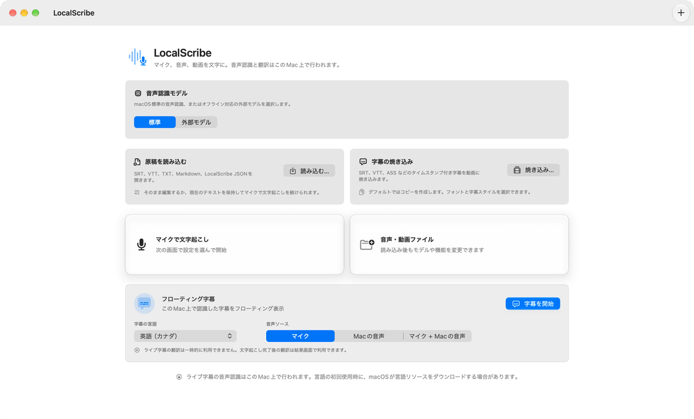
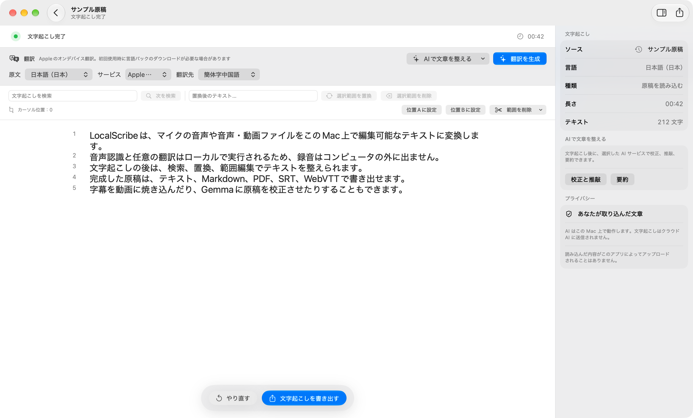

# LocalScribe

[英語](README.md) | [簡体字中国語](README.zh-CN.md) | **日本語**

**マイクの音声、音声・動画ファイル、Macで再生中の音を、そのMac上で編集可能なテキストと字幕に。**

LocalScribeは、Appleシリコン搭載Mac向けの無料・オープンソースのネイティブmacOSアプリです。文字起こし、編集、翻訳、動画への字幕の焼き込みをひとつのアプリで行えます。対応するMacでは、**Apple Intelligenceによるオンデバイスの翻訳・校正・要約**も利用できます。ローカルでの作業にアカウント登録は不要です。

現在のリリース：**1.9.0** · [リリースノート（英語）](https://github.com/maddylaneeee/ShengJi/releases/latest) · [DMGをダウンロード](https://github.com/maddylaneeee/ShengJi/releases/latest/download/LocalScribe-macOS-arm64.dmg)

<picture>
  <source media="(prefers-color-scheme: dark)" srcset="Documentation/MediaKit/localscribe-demo-ja-dark.gif">
  
</picture>

*プレビューとスクリーンショットは以前のバージョンのものです。AIやプライバシーの表示は現在と異なる場合があります。現在の動作は以下をご覧ください。*

## ダウンロードとインストール

1. [最新のDMGをダウンロード](https://github.com/maddylaneeee/ShengJi/releases/latest/download/LocalScribe-macOS-arm64.dmg)します。
2. DMGを開き、LocalScribeを「アプリケーション」にドラッグします。
3. インストールしたアプリを一度開きます。macOSにブロックされた場合は、[初回起動ガイド（英語）](INSTALL.md)をご覧ください。「このまま開く」が表示されない場合の手順もあります。

> [!WARNING]
> 公開パッケージは完全性を確認するアドホック署名のみで、Developer ID署名もAppleの公証も受けていません。このリポジトリと配布元を信頼できる場合のみ例外を許可してください。SHA-256の確認方法は[ダウンロードガイド（英語）](Documentation/DOWNLOAD.md)にあります。

## できること

- **3種類の音源を文字起こし：** マイク、音声・動画ファイル、Macの音声。結果を順次表示し、中断したタスクを復元できます。
- **フローティング字幕：** macOS 26以降で、マイク、Macの音声、または両方を混ぜた入力に対応します。
- **原稿の編集と書き出し：** 文章や字幕を読み込み、検索・置換・範囲指定での切り詰めを行い、TXT、Markdown、JSON、PDF、SRT、WebVTTで書き出せます。
- **Apple Intelligenceで翻訳と整理：** オンデバイス翻訳、変更をリアルタイムに確認できる校正、長い原稿の要約。AIの出力は使用前に確認してください。
- **動画への字幕の焼き込み：** フォントとスタイルを選び、プレビューしながら字幕付きのコピーを保存できます。
- **マイクの元音声を保存：** 任意でM4Aを保存し、原稿と一緒に書き出せます。
- **使いやすい言語と操作方法：** 英語・簡体字中国語・日本語のUI、ライト／ダーク表示、文字起こし・翻訳・モデル管理・字幕焼き込み用のCLI。

<picture>
  <source media="(prefers-color-scheme: dark)" srcset="Documentation/Screenshots/transcript-editor-ja-dark.png">
  
</picture>

## Apple Intelligenceとエンジンの選択

対応するMacで、**macOS 26以降を使用し、Apple Intelligenceがオンでシステムモデルの準備ができている**場合、システムのオンデバイスモデルで翻訳や文章の整理を行えます。アプリで管理するAIモデルを別途ダウンロードする必要はありません。GemmaやNLLBがインストール済みの状態で更新すると、保持するかApple Intelligenceに切り替えるかを選べます。後で設定から切り替えることもできます。

標準の翻訳サービスは引き続きApple翻訳です。Apple Intelligenceも選択でき、非対応言語や処理できない部分はApple翻訳に切り替わります。Apple Intelligenceを利用できないMacではGemma 4で文章を整理し、任意のNLLBで翻訳できます。校正と要約には、LM Studio、OpenAI、DeepSeekのカスタムサービスも利用できます。

音声認識はApple Speech、Whisper、SenseVoice、NVIDIA Parakeetから選べます。システムと言語が対応している場合はApple Speechをまず試してください。結果は言語、録音品質、用途によって変わります。エンジンの比較表は[ユーザーガイド（英語）](Documentation/USAGE.md)、動作条件や切り替えの説明は[AIガイド（英語）](Documentation/AI-SERVICES.md)をご覧ください。

## 動作環境とプライバシー

- **macOS 15.5以降、Appleシリコン（`arm64`）。** Intel Macには対応していません。
- **Apple Speechの音声認識とフローティング字幕にはmacOS 26以降が必要です。** macOS 15.5–25ではWhisper、SenseVoice、Parakeetを選んでダウンロードしてください。SenseVoiceとParakeetはファイルのみ対応しています。
- Apple Intelligenceには対応するMacと準備済みのシステムモデルが必要です。macOS 26での動作は実機で未検証で、開発と実際のモデルのテストはmacOS 27で行いました。
- ライブ字幕の翻訳は現在無効です。文字起こし後の翻訳は利用できます。
- マイクにはマイクのアクセス権、Macの音声には「画面収録とシステムオーディオ録音」のアクセス権が必要です。初回利用前にシステムの言語・AIリソースのダウンロードが必要な場合があります。

音声認識はMac上で行い、元の音声や動画をアップロードしません。翻訳と内蔵AIもローカルで動作します。クラウドAIを選んで同意した場合のみ、タスクの文章・文脈・指示を送信し、API料金が発生する場合があります。キーは同期しない本機のキーチェーンに保存します。[プライバシーとアップデート（英語）](Documentation/USAGE.md#privacy-and-updates)もご覧ください。

## ガイドとフィードバック

- [ユーザーガイド：文字起こし、編集、字幕焼き込み、音声、ショートカット、CLI（英語）](Documentation/USAGE.md)
- [AIによる文章の整理とカスタムサービス（英語）](Documentation/AI-SERVICES.md)
- [初回起動（英語）](INSTALL.md) · [ダウンロードと検証（英語）](Documentation/DOWNLOAD.md)
- [Webサイト（英語・簡体字中国語）](https://lixinchen.ca/docs/localscribe/) · [ロードマップ（英語）](ROADMAP.md)
- [ビルド・テスト・開発への参加（英語）](CONTRIBUTING.md) · [不具合を報告](https://github.com/maddylaneeee/ShengJi/issues)

## ライセンス

LocalScribeのソースは[MITライセンス](LICENSE)で公開しています。外部ランタイムとモデルにはそれぞれのライセンスが適用されます。[THIRD_PARTY_NOTICES.md（英語）](THIRD_PARTY_NOTICES.md)をご覧ください。任意のNLLBモデルは配布元によりCC-BY-NC-4.0で提供されています。
