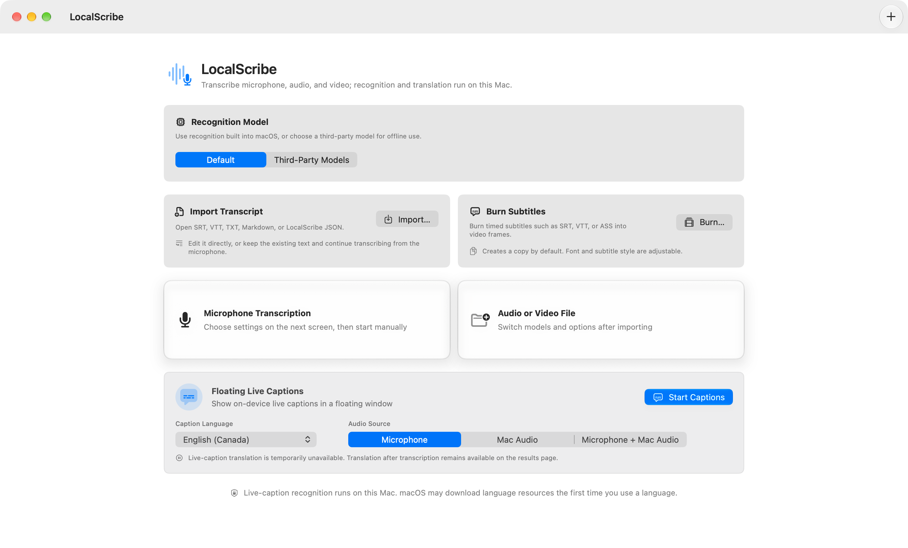

# LocalScribe

**English** | [Chinese (Simplified)](README.zh-CN.md) | [Japanese](README.ja.md)

[](https://support.apple.com/macos)
[](https://support.apple.com/guide/mac-help/about-this-mac-mchl3a2c2cb0/mac)
[](LICENSE)
[](https://github.com/maddylaneeee/ShengJi/actions/workflows/ci.yml)
[](https://github.com/maddylaneeee/ShengJi/releases/latest/download/LocalScribe-macOS-arm64.dmg)

**Turn microphones, media files, and the sound playing on your Mac into editable text and subtitles—locally.**

LocalScribe is a free, open-source, native SwiftUI transcription app for Apple silicon Macs. No account is required. It combines local speech recognition, floating live captions, transcript editing, subtitle export and burning, offline translation, long-task recovery, and on-device Gemma 4 transcript enhancement. Recognition audio never leaves the Mac; AI runs locally unless you choose a cloud service.

Current release: **1.8.1 (44)** · [Release notes](https://github.com/maddylaneeee/ShengJi/releases) · [Download DMG](https://github.com/maddylaneeee/ShengJi/releases/latest/download/LocalScribe-macOS-arm64.dmg) · [User documentation](https://lixinchen.ca/docs/localscribe/)

<picture>
  <source media="(prefers-color-scheme: dark)" srcset="Documentation/MediaKit/localscribe-demo-en-dark.gif">
  
</picture>

> [!IMPORTANT]
> The app supports macOS 15.5 or later, but **Apple Speech recognition and floating live captions require macOS 26**. On macOS 15.5–25, select Whisper, SenseVoice, or Parakeet on the home screen.

## Download and install

1. [Download the latest DMG](https://github.com/maddylaneeee/ShengJi/releases/latest/download/LocalScribe-macOS-arm64.dmg).
2. Open it and drag LocalScribe to Applications.
3. Open the app once. If macOS blocks it, go to System Settings → Privacy & Security, choose **Open Anyway** for LocalScribe, and confirm.

See the [first-launch guide](INSTALL.md) (including what to do if Open Anyway is missing) and the [Download and Installation Guide](Documentation/DOWNLOAD.md) for illustrated steps and SHA-256 verification.

> [!WARNING]
> Release builds have an ad-hoc signature only and are neither Developer ID signed nor notarized by Apple. Override the warning only if you trust this repository. Every Release includes SHA-256 files.

## Features

- **Three input sources.** Transcribe from a microphone (system default or a chosen input device), audio/video files, or the sound playing on your Mac.
- **Floating live captions** (macOS 26) for microphone, Mac audio, or both mixed.
- **Four offline recognition engines.** Apple Speech, whisper.cpp with Metal, SenseVoice, and NVIDIA Parakeet; models are downloaded only when selected.
- **Transcript editing.** Search, replace, delete selections, and trim ranges, with smooth scrolling for long transcripts.
- **Import and continue.** Open SRT, WebVTT, TXT, Markdown, or LocalScribe JSON, edit it, or append new microphone transcription to it.
- **Export.** TXT, Markdown, JSON, PDF, SRT, WebVTT, or the clipboard.
- **Translation after transcription** with Apple Translation, or optional local NLLB.
- **AI transcript enhancement.** Proofread, refine, or summarize with on-device Gemma 4, or a custom LM Studio, OpenAI, or DeepSeek service.
- **Burn subtitles into video** with your own font and style.
- **Save original microphone audio** and export it as M4A alongside the transcript.
- **Long-task safety.** Progressive results, pause/resume, append-only journals, and recovery after interruption.
- **Command-line interface** for models, transcription, translation, and subtitle burning.
- **English, Simplified Chinese, and Japanese interfaces.** The app follows the macOS language by default and can switch instantly in Settings, along with System, Light, or Dark appearance.

<picture>
  <source media="(prefers-color-scheme: dark)" srcset="Documentation/Screenshots/home-en-dark.png">
  
</picture>

<picture>
  <source media="(prefers-color-scheme: dark)" srcset="Documentation/Screenshots/transcript-editor-en-dark.png">
  
</picture>

## Recognition and translation engines

**Prefer Apple's built-in engines when your macOS version and language support them**; their quality is noticeably better than the third-party models.

| Engine | Use | Runtime |
| --- | --- | --- |
| Apple Speech | Microphone, files, live captions (macOS 26) | SpeechAnalyzer / SpeechTranscriber |
| Whisper | Microphone and files | whisper.cpp GGML, Metal with CPU fallback |
| SenseVoice | Files | sherpa-onnx, Core ML where eligible, CPU fallback |
| NVIDIA Parakeet | Files | sherpa-onnx, Core ML where eligible, CPU fallback |
| Apple Translation | Default post-transcription translation | macOS Translation framework |
| NLLB | Optional post-transcription translation | CTranslate2 CPU/int8 |
| Gemma 4 | Proofreading, refinement, summarization | llama.cpp with Metal, on device |

Whisper uses the bundled Silero VAD to skip silence in long media and filters silent, low-confidence, repeated, and known hallucinated output.

**Advanced settings.** For third-party engines, the collapsed Advanced section in the right inspector exposes the options each runtime supports—for Whisper: prompt, temperature and fallback, beam or greedy search, context length, silence and confidence filters, VAD, and thread count. The last engine, model, and settings are remembered; **Restore Model Defaults** resets only the selected engine.

## AI transcript enhancement

After transcribing or importing a transcript, open **AI Enhancement** in the right inspector.

- **Proofread / Refine** removes filler, repetition, and obvious recognition errors, shown as a live diff. Segments that fail validation keep their original text.
- **Summarize** replaces the preview with a summary and keeps an undo snapshot.
- Add one-time or saved instructions for names, terminology, style, length, focus, or format. Always review AI output.

**Built-in Gemma 4.** The default E2B model is about 2.8 GB; an optional E4B model (about 4.6 GB) can be enabled in Settings. Models are downloaded on demand and load only when you select an AI task; LocalScribe first releases its recognition and NLLB runtimes. On Macs with 8 GB of memory or less, Gemma is off by default and can be enabled in Settings.

**Custom AI services.** In **Settings → Models → Use a custom AI service**, connect LM Studio (loopback address only, default `http://127.0.0.1:1234/v1`), OpenAI, or DeepSeek. Enabling it cancels and blocks Gemma downloads and loading, with no automatic fallback. OpenAI and DeepSeek connectors are previews and send task text only after your consent; API usage may incur charges. See the [setup guide](Documentation/AI-SERVICES.md).

## Burn subtitles into video

Open **Burn Subtitles** on the home screen or choose **File → Burn Subtitles…** (⇧⌘B). Choose or drag in a video (MP4, MOV, M4V, or another format macOS can play) and a subtitle file: SRT, WebVTT, LocalScribe JSON, ASS/SSA, SBV, or TTML/DFXP. Files without valid timestamps are flagged as unsupported; ASS styling and TTML regions are ignored.

After a video transcription, **Burn into Video** next to Export opens the same page with the original or translated text currently shown.

- **Output:** Create Copy (default) or Burn into Original, which replaces the source only after the new file is rendered and verified.
- **Style:** any installed font, size, top or bottom position and margin, optional background, and adjustable shadow, with a live preview. The style is remembered.
- Rendering uses AVFoundation, keeps the source resolution and orientation, and re-encodes as HEVC for HEVC sources or H.264 otherwise.

## Save original microphone audio

Before starting a new microphone transcription, turn on **Save Original Audio** and pick Storage Priority, Quality Priority, or Highest Quality (AAC or ALAC in M4A). Afterwards, play it back at 0.5×, 1×, or 2× and export it with the transcript under the same base filename. Editing or translating the transcript never changes the audio. This option is unavailable for file transcription, Mac audio, live captions, and transcription appended to an imported transcript.

## Keyboard shortcuts

| Shortcut | Action |
| --- | --- |
| ⌘N | Microphone transcription |
| ⌘O | Transcribe from file |
| ⇧⌘O | Import transcript |
| ⇧⌘B | Burn subtitles |
| Return | Start transcription |
| Space | Pause / resume |
| ⌘E | Export transcript |

## Requirements and limitations

- macOS 15.5 or later on Apple silicon (`arm64`). Intel Macs are not supported.
- Apple Speech recognition and live captions require macOS 26.
- SenseVoice and Parakeet support file transcription only.
- Live-caption translation is currently disabled; post-transcription translation is available.
- Local NLLB translation requires at least 4 GB of memory.
- Microphone input needs microphone permission; Mac audio needs Screen & System Audio Recording permission. Apple Speech and Apple Translation may download language assets managed by macOS.

## Privacy and updates

Recognition and translation run on the Mac, and neither recognition audio nor text processed by built-in Gemma is uploaded. LM Studio receives text over loopback on the same Mac. OpenAI or DeepSeek receive task text, context, and instructions only after you select and confirm them. API keys are stored in the local, non-synchronizing Keychain.

Other network access is limited to on-demand model downloads, update checks and downloads, and opening external documentation. The updater checks at launch and every six hours, reads `update.json` from the latest GitHub Release, verifies the ZIP's SHA-256, bundle identifier, and version, and asks before replacing the app. Automatic updates can be turned off in Settings.

## Command line

```sh
LS=/Applications/LocalScribe.app/Contents/MacOS/LocalScribe

$LS --cli help
$LS --cli models --json
$LS --cli download whisper.largeV3TurboQ5
$LS --cli transcribe input.mp4 --engine whisper --language en_US \
  --translate-to zh-Hans --format srt --output output.srt
$LS --cli translate "Hello" --source en_US --target ja
$LS --cli burn --video input.mp4 --subtitles input.srt --output subtitled.mp4
```

| Command | Purpose |
| --- | --- |
| `models [--json]` | List models and installation state |
| `download <model-id>` / `remove <model-id>` | Install or uninstall a recognition model |
| `transcribe <file>` | Transcribe with Whisper, SenseVoice, or Parakeet; options include `--model`, `--compute auto\|coreml\|metal\|cpu`, `--translate-to`, `--translation-provider apple\|nllb`, and `--format txt\|md\|json\|pdf\|srt\|vtt` |
| `translate <text>` | Translate text with Apple Translation (macOS 26) or NLLB |
| `burn` | Burn subtitles; supports `--in-place`, `--overwrite`, `--font`, `--size`, `--position`, `--margin`, `--background`, and shadow options |

## Build from source

Requires Xcode and its Command Line Tools. Native runtimes are included in the repository; large models are downloaded only when selected.

```sh
ruby generate_project.rb
xcodebuild -project LocalScribe.xcodeproj -scheme LocalScribe \
  -destination 'platform=macOS,arch=arm64' build
xcodebuild -project LocalScribe.xcodeproj -scheme LocalScribe \
  -destination 'platform=macOS,arch=arm64' test
```

CI runs tests and Release static analysis on macOS 26 Apple silicon. `./tools/package_local_release.sh` builds and validates ZIP and DMG packages (`CODESIGN_IDENTITY=-` for an ad-hoc build). Pushing a tag that matches the `Info.plist` version, such as `v1.8.1`, publishes a GitHub Release through `release-unsigned.yml`.

## Documentation

- [User documentation](https://lixinchen.ca/docs/localscribe/)
- [Download and Installation Guide](Documentation/DOWNLOAD.md)
- [Custom AI services](Documentation/AI-SERVICES.md)
- [Roadmap](ROADMAP.md)
- [Contributing](CONTRIBUTING.md)
- [Report an issue](https://github.com/maddylaneeee/ShengJi/issues)

## License

LocalScribe is available under the [MIT License](LICENSE). Third-party components and models keep their own licenses; see [THIRD_PARTY_NOTICES.md](THIRD_PARTY_NOTICES.md) and the license files under `Vendor`. The optional NLLB model is distributed upstream under CC-BY-NC-4.0.
