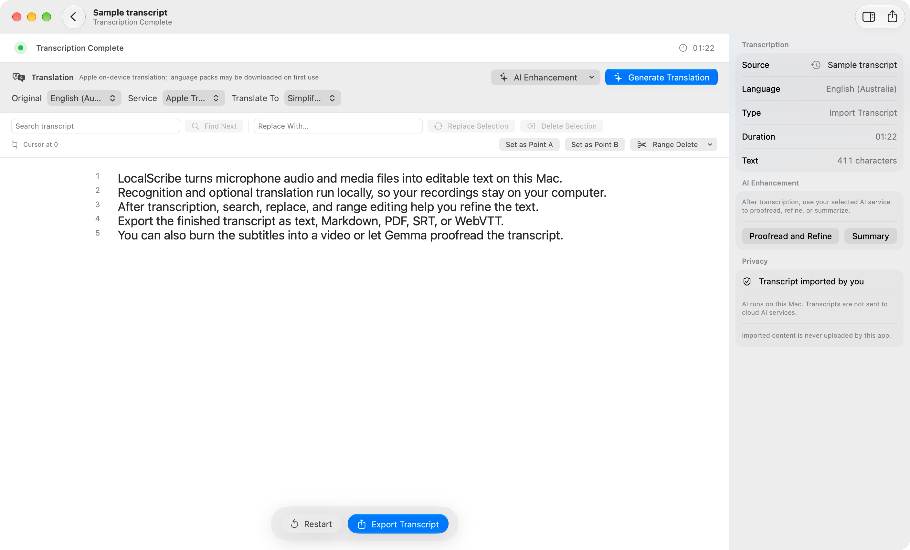

# LocalScribe

**English** | [Chinese (Simplified)](README.zh-CN.md) | [Japanese](README.ja.md)

**Turn microphones, media files, and the sound playing on your Mac into editable text and subtitles—locally.**

LocalScribe is a free, open-source, native macOS app for Apple silicon Macs. Transcribe, edit, translate, and burn subtitles into video in one app, with **on-device Apple Intelligence for translation, proofreading, and summaries** on supported Macs. No account is required for local workflows.

Current release: **1.9.0** · [Release notes](https://github.com/maddylaneeee/ShengJi/releases/latest) · [Download DMG](https://github.com/maddylaneeee/ShengJi/releases/latest/download/LocalScribe-macOS-arm64.dmg)

<picture>
  <source media="(prefers-color-scheme: dark)" srcset="Documentation/MediaKit/localscribe-demo-en-dark.gif">
  
</picture>

*Preview and screenshots show earlier releases. Their AI and privacy notes may differ; see the current behavior below.*

## Download and install

1. [Download the latest DMG](https://github.com/maddylaneeee/ShengJi/releases/latest/download/LocalScribe-macOS-arm64.dmg).
2. Open it and drag LocalScribe to Applications.
3. Try opening the installed app once. If macOS blocks it, follow the [first-launch guide](INSTALL.md), including what to do if **Open Anyway** is missing.

> [!WARNING]
> Public builds have an ad-hoc integrity signature only; they are not Developer ID signed or notarized by Apple. Approve an exception only if you trust this repository and download source. See the [download guide](Documentation/DOWNLOAD.md) for SHA-256 verification.

## What you can do

- **Transcribe three sources:** microphone, audio/video files, or Mac audio, with progressive results and recovery after interruption.
- **Follow floating live captions:** microphone, Mac audio, or both mixed, on macOS 26 or later.
- **Edit and deliver transcripts:** import text or subtitles, search, replace, trim ranges, and export TXT, Markdown, JSON, PDF, SRT, or WebVTT.
- **Translate and improve text with Apple Intelligence:** on-device translation, proofreading with a live change preview, and summaries of long transcripts. Review AI output before using it.
- **Burn subtitles into video:** choose a font and style, preview the result, and save a subtitled copy.
- **Keep original microphone audio:** optionally save and export M4A alongside the transcript.
- **Work in your preferred language:** English, Simplified Chinese, and Japanese interfaces, light/dark appearance, and a CLI for transcription, translation, models, and subtitle burning.

<picture>
  <source media="(prefers-color-scheme: dark)" srcset="Documentation/Screenshots/transcript-editor-en-dark.png">
  
</picture>

## Apple Intelligence and engine choices

On supported Macs with **macOS 26 or later and Apple Intelligence enabled and ready**, LocalScribe can use the system's on-device model for translation and AI enhancement. You do not need a separate app-managed AI model download. When upgrading with Gemma or NLLB installed, you can keep those models or switch to Apple Intelligence; the choice is also available in Settings.

Apple Translation remains the default translation provider. Apple Intelligence is another option, with Apple Translation fallback for unsupported languages or segments it cannot process. Macs without Apple Intelligence can use Gemma 4 for AI enhancement and optional NLLB for translation. Custom LM Studio, OpenAI, and DeepSeek services are also available for proofreading and summaries.

Recognition choices are Apple Speech, Whisper, SenseVoice, and NVIDIA Parakeet. When your system and language support Apple Speech, try it first; results vary with language, recording quality, and task. See the [user guide](Documentation/USAGE.md) for the engine table and [AI guide](Documentation/AI-SERVICES.md) for model choices and fallback behavior.

## Requirements and privacy

- **macOS 15.5 or later, Apple silicon (`arm64`).** Intel Macs are not supported.
- **Apple Speech recognition and floating live captions require macOS 26 or later.** On macOS 15.5–25, select and download Whisper, SenseVoice, or Parakeet. SenseVoice and Parakeet support files only.
- Apple Intelligence requires a supported Mac and system model readiness. Its macOS 26 path has not yet been tested on real hardware; development and live testing used macOS 27.
- Live-caption translation is currently disabled; translation after transcription is available.
- Microphone input requires microphone permission; Mac audio requires Screen & System Audio Recording permission. System language and AI resources may need to download before use.

Recognition runs on your Mac and does not upload original audio or video. Translation and built-in AI also run locally. Only when you choose a cloud AI service and consent does LocalScribe send task text, context, and instructions to that provider; API usage may incur charges. Keys stay in this Mac's non-synchronizing Keychain. See [privacy and updates](Documentation/USAGE.md#privacy-and-updates).

## Guides and feedback

- [User guide: transcription, editing, subtitle burning, audio, shortcuts, and CLI](Documentation/USAGE.md)
- [AI enhancement and custom services](Documentation/AI-SERVICES.md)
- [First launch](INSTALL.md) · [Download and verification](Documentation/DOWNLOAD.md)
- [Website](https://lixinchen.ca/docs/localscribe/) · [Roadmap](ROADMAP.md)
- [Build, test, and contribute](CONTRIBUTING.md) · [Report an issue](https://github.com/maddylaneeee/ShengJi/issues)

## License

LocalScribe's source is available under the [MIT License](LICENSE). Third-party runtimes and models keep their own licenses; see [THIRD_PARTY_NOTICES.md](THIRD_PARTY_NOTICES.md). The optional NLLB model is provided upstream under CC-BY-NC-4.0.
