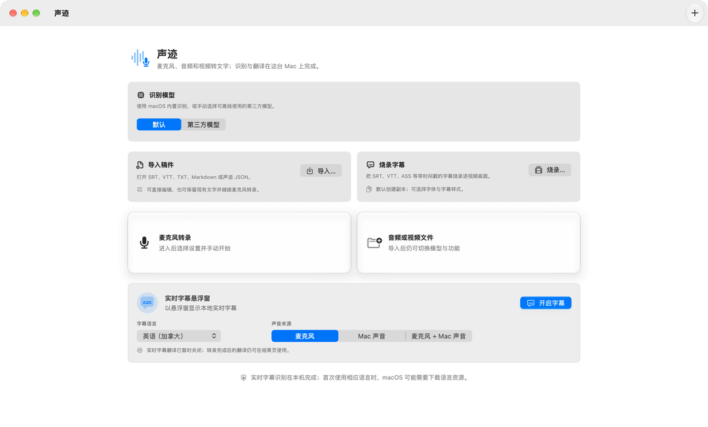

# 声迹

[English](README.md) | **简体中文** | [日本語](README.ja.md)

**把麦克风、音视频文件和 Mac 正在播放的声音，在本机转成可编辑文字与字幕。**

声迹是一款面向 Apple silicon Mac 的免费开源原生 macOS 应用。在一个 App 中完成转录、编辑、翻译和字幕烧录，并在受支持的 Mac 上用 **Apple 智能在本机翻译、纠错和总结**。本地工作流无需注册账号。

当前版本：**1.9.0** · [发布说明](https://github.com/maddylaneeee/ShengJi/releases/latest) · [下载 DMG](https://github.com/maddylaneeee/ShengJi/releases/latest/download/LocalScribe-macOS-arm64.dmg)

<picture>
  <source media="(prefers-color-scheme: dark)" srcset="Documentation/MediaKit/shengji-demo-dark.gif">
  
</picture>

*预览和截图展示较早版本，其中的 AI 与隐私提示可能与当前不同；现行说明见下文。*

## 下载与安装

1. [下载最新版 DMG](https://github.com/maddylaneeee/ShengJi/releases/latest/download/LocalScribe-macOS-arm64.dmg)。
2. 打开 DMG，把 `LocalScribe.app`（中文系统中显示为“声迹”）拖到“应用程序”。
3. 先尝试打开安装后的 App。若 macOS 阻止启动，按[首次启动指南](INSTALL.zh-CN.md)操作，其中包含找不到“仍要打开”时的处理。

> [!WARNING]
> 公开包只有 ad-hoc 完整性签名，没有 Developer ID 签名，也未经 Apple 公证。只有信任本仓库及下载来源时才应批准例外。SHA-256 校验见[下载指南](Documentation/DOWNLOAD.zh-CN.md)。

## 可以做什么

- **转录三种来源：** 麦克风、音视频文件或 Mac 声音；结果逐步显示，中断后可恢复。
- **悬浮实时字幕：** 在 macOS 26 或更高版本上，使用麦克风、Mac 声音或两者混合。
- **编辑与交付稿件：** 导入已有文本或字幕，搜索、替换、范围裁剪，导出 TXT、Markdown、JSON、PDF、SRT 或 WebVTT。
- **用 Apple 智能翻译与整理：** 本机翻译、带实时修改预览的纠错，以及长稿件总结；使用前请复核 AI 输出。
- **把字幕烧进视频：** 选择字体与样式，实时预览，另存带字幕的视频副本。
- **保留麦克风原音：** 可选保存 M4A，并与文字稿一起导出。
- **按习惯使用：** 中、英、日三语界面，浅色与深色外观，以及支持转录、翻译、模型管理和字幕烧录的命令行。

<picture>
  <source media="(prefers-color-scheme: dark)" srcset="Documentation/Screenshots/transcript-editor-zh-CN-dark.png">
  
</picture>

## Apple 智能与引擎选择

在受支持的 Mac 上，**运行 macOS 26 或更高版本，且 Apple 智能已开启、系统模型已就绪**时，声迹可使用系统本机模型完成翻译与文稿优化，无需另行下载应用管理的 AI 模型。更新时若已安装 Gemma 或 NLLB，可选择保留，或切换到 Apple 智能；之后也可在设置中切换。

Apple Translation 仍是默认翻译服务。Apple 智能是另一选项，不支持的语言或无法处理的片段会回退到 Apple Translation。无法使用 Apple 智能的 Mac 可用 Gemma 4 整理稿件、用可选 NLLB 翻译；纠错和总结也可接入自定义 LM Studio、OpenAI 或 DeepSeek 服务。

语音识别可选 Apple Speech、Whisper、SenseVoice 和 NVIDIA Parakeet。系统与语言支持 Apple Speech 时可先尝试；实际效果取决于语言、录音质量与任务。[使用指南](Documentation/USAGE.zh-CN.md)列有引擎对照，[AI 指南](Documentation/AI-SERVICES.zh-CN.md)说明模型选择、可用条件与回退行为。

## 系统要求与隐私

- **macOS 15.5 或更高版本，Apple silicon（`arm64`）。** 不支持 Intel Mac。
- **Apple Speech 识别和悬浮实时字幕需要 macOS 26 或更高版本。** macOS 15.5–25 请先选择并下载 Whisper、SenseVoice 或 Parakeet；后两者仅支持文件。
- Apple 智能需要受支持的 Mac 与已就绪的系统模型。macOS 26 路径尚未经过实机验证，开发与实际模型测试使用 macOS 27。
- 实时字幕翻译当前关闭，转录后翻译可用。
- 麦克风输入需要麦克风权限；Mac 声音需要“屏幕与系统音频录制”权限。首次使用前，系统可能需要下载语言或 AI 资源。

识别在本机完成，不上传原始音视频；翻译与内置 AI 也在本机运行。只有主动选择云端 AI 服务并确认后，才会向该服务发送任务文本、上下文和指令，API 调用可能产生费用。密钥保存在本机不参与同步的 Keychain。详见[隐私与更新](Documentation/USAGE.zh-CN.md#隐私与更新)。

## 指南与反馈

- [使用指南：转录、编辑、字幕烧录、音频、快捷键与命令行](Documentation/USAGE.zh-CN.md)
- [AI 文稿优化与自定义服务](Documentation/AI-SERVICES.zh-CN.md)
- [首次启动](INSTALL.zh-CN.md) · [下载与校验](Documentation/DOWNLOAD.zh-CN.md)
- [官网](https://lixinchen.ca/docs/localscribe/) · [路线图（英文）](ROADMAP.md)
- [构建、测试与参与贡献（英文）](CONTRIBUTING.md) · [提交问题](https://github.com/maddylaneeee/ShengJi/issues)

## 许可证

项目源码使用 [MIT License](LICENSE)。第三方运行时与模型保留各自许可证，详见 [THIRD_PARTY_NOTICES.md](THIRD_PARTY_NOTICES.md)。可选 NLLB 模型由上游以 CC-BY-NC-4.0 提供。
