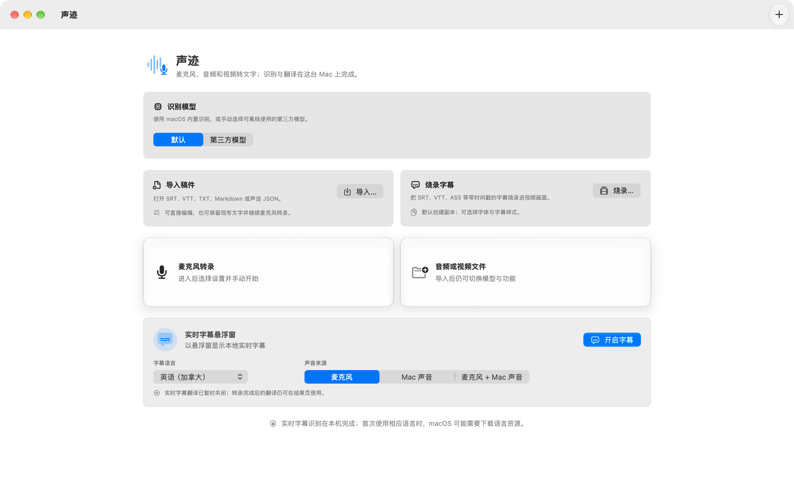
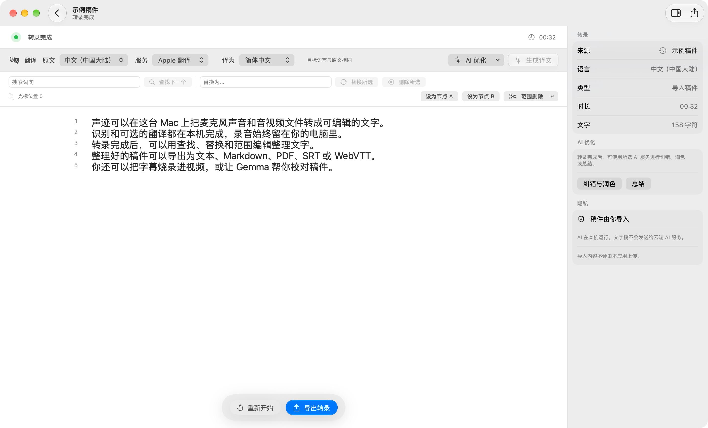

# 声迹

[English](README.md) | **简体中文** | [日本語](README.ja.md)

[](https://support.apple.com/macos)
[](https://support.apple.com/guide/mac-help/about-this-mac-mchl3a2c2cb0/mac)
[](LICENSE)
[](https://github.com/maddylaneeee/ShengJi/actions/workflows/ci.yml)
[](https://github.com/maddylaneeee/ShengJi/releases/latest/download/LocalScribe-macOS-arm64.dmg)

**把麦克风、音视频文件和 Mac 正在播放的声音，在本机转成可编辑文字与字幕。**

声迹是一款面向 Apple silicon Mac 的免费、开源 SwiftUI 原生转录应用，无需注册账号。它整合了本地语音识别、悬浮实时字幕、稿件编辑、字幕导出与烧录、离线翻译、长任务恢复，以及本机 Gemma 4 文稿优化。识别音频始终留在本机；除非你主动选择云端服务，AI 也在本机运行。

当前版本：**1.8.1（44）** · [发布说明](https://github.com/maddylaneeee/ShengJi/releases) · [下载 DMG](https://github.com/maddylaneeee/ShengJi/releases/latest/download/LocalScribe-macOS-arm64.dmg) · [使用文档](https://lixinchen.ca/docs/localscribe/)

<picture>
  <source media="(prefers-color-scheme: dark)" srcset="Documentation/MediaKit/shengji-demo-dark.gif">
  
</picture>

> [!IMPORTANT]
> App 支持 macOS 15.5 及以上，但 **Apple Speech 识别和悬浮实时字幕需要 macOS 26**。在 macOS 15.5–25 上，请在首页选择 Whisper、SenseVoice 或 Parakeet。

## 下载与安装

1. [下载最新版 DMG](https://github.com/maddylaneeee/ShengJi/releases/latest/download/LocalScribe-macOS-arm64.dmg)。
2. 打开 DMG，把 `LocalScribe.app`（中文系统中显示为“声迹”）拖到“应用程序”。
3. 先打开一次 App。若 macOS 阻止启动，进入“系统设置 → 隐私与安全性”，为声迹选择“仍要打开”并确认。

详见[首次启动指南](INSTALL.zh-CN.md)（含找不到“仍要打开”时的处理）和[下载与安装指南](Documentation/DOWNLOAD.zh-CN.md)（图文步骤与 SHA-256 校验）。

> [!WARNING]
> 发布包只有 ad-hoc 签名，没有 Apple Developer ID 签名，也未经 Apple 公证。只有在信任本仓库时才应绕过系统警告。每个 Release 都附带 SHA-256 校验文件。

## 功能

- **三种输入来源：** 麦克风（系统默认或指定输入设备）、音视频文件，以及 Mac 正在播放的声音。
- **悬浮实时字幕**（macOS 26）：支持麦克风、Mac 声音或两者混合。
- **四种离线识别引擎：** Apple Speech、Metal 加速的 whisper.cpp、SenseVoice、NVIDIA Parakeet；模型仅在选择后下载。
- **稿件编辑：** 查找、替换、删除选中内容、范围裁剪；长稿件也能流畅滚动。
- **导入并继续：** 打开 SRT、WebVTT、TXT、Markdown 或声迹 JSON 进行编辑，或在其后继续麦克风转录。
- **导出：** TXT、Markdown、JSON、PDF、SRT、WebVTT 或复制到剪贴板。
- **转录后翻译：** 默认 Apple Translation，也可选本地 NLLB。
- **AI 文稿优化：** 用本机 Gemma 4，或自定义的 LM Studio、OpenAI、DeepSeek 服务进行纠错、润色或总结。
- **字幕烧录到视频**，可自定义字体与样式。
- **保存麦克风原音**，并与稿件一同导出 M4A。
- **长任务保护：** 逐步显示结果、暂停与继续、追加式记录，中断后可恢复。
- **命令行工具：** 管理模型、转录、翻译和烧录字幕。
- **English／简体中文／日本語界面：** 默认跟随 macOS 语言，可在设置中即时切换语言及系统／浅色／深色外观。

<picture>
  <source media="(prefers-color-scheme: dark)" srcset="Documentation/Screenshots/home-zh-CN-dark.png">
  
</picture>

<picture>
  <source media="(prefers-color-scheme: dark)" srcset="Documentation/Screenshots/transcript-editor-zh-CN-dark.png">
  
</picture>

## 识别与翻译引擎

**系统版本和语言支持时，优先使用 Apple 原生引擎**，其效果明显优于第三方模型。

| 引擎 | 用途 | 运行方式 |
| --- | --- | --- |
| Apple Speech | 麦克风、文件、实时字幕（macOS 26） | SpeechAnalyzer / SpeechTranscriber |
| Whisper | 麦克风、文件 | whisper.cpp GGML，Metal → CPU |
| SenseVoice | 文件 | sherpa-onnx，Core ML 可用路径 → CPU |
| NVIDIA Parakeet | 文件 | sherpa-onnx，Core ML 可用路径 → CPU |
| Apple Translation | 默认转录后翻译 | macOS Translation Framework |
| NLLB | 可选转录后翻译 | CTranslate2 CPU/int8 |
| Gemma 4 | 纠错、润色、总结 | llama.cpp，Metal 本机推理 |

Whisper 对较长素材使用内置 Silero VAD 跳过静音，并过滤静音、低置信度、机械重复和已知幻觉输出。

**高级设置：** 使用第三方引擎时，右侧检查器中默认收起的“高级”区域只显示该运行时真实支持的选项。Whisper 可调模型提示词、Temperature 与回退、Beam 或贪心搜索、上下文长度、静音与置信度过滤、VAD 和线程数。应用会记住上次的引擎、模型和设置；“恢复模型默认参数”只重置当前引擎。

## AI 文稿优化

完成转录或导入稿件后，打开右侧检查器的“AI 优化”。

- **纠错／润色：** 清理口头填充词、重复和明显识别错误，以实时对照显示；未通过校验的片段保留原文。
- **总结：** 用总结替换文字预览，并保留可撤销的原稿快照。
- 可临时或长期指定人名、术语、风格、长度、重点或格式。AI 输出仍需人工复核。

**内置 Gemma 4：** 默认 E2B 模型约 2.8 GB，可在设置中启用约 4.6 GB 的 E4B 模型。模型按需下载，仅在选择 AI 任务后加载，加载前会释放识别与 NLLB 运行环境。8 GB 及以下内存的 Mac 默认关闭，可在设置中手动开启。

**自定义 AI 服务源：** 在“设置 → 模型 → 使用自定义ai服务源”中接入 LM Studio（仅本机回环地址，默认 `http://127.0.0.1:1234/v1`）、OpenAI 或 DeepSeek。开启后取消并禁止 Gemma 下载与加载，不会自动回退。OpenAI 和 DeepSeek 为预览功能，经你确认后才发送任务文字，调用可能产生费用。详见[配置指南](Documentation/AI-SERVICES.zh-CN.md)。

## 字幕烧录到视频

在首页点击“烧录字幕”，或选择“文件 → 烧录字幕…”（⇧⌘B）。选择或拖入视频（MP4、MOV、M4V 等 macOS 可播放的格式）和字幕文件：SRT、WebVTT、声迹 JSON、ASS/SSA、SBV、TTML/DFXP。没有有效时间戳的文件会标为不支持；ASS 样式和 TTML 区域会被忽略。

视频转录完成后，点“导出转录”旁的“烧录到视频”，会带着当前显示的原文或译文打开同一页面。

- **输出：** 创建副本（默认），或烧录到原视频（新文件渲染并校验成功后才替换原文件）。
- **样式：** 本机任意字体、字号、顶部或底部位置与边距、可选背景、可调阴影，并带实时预览；样式会被记住。
- 使用 AVFoundation 渲染，保留原分辨率和方向；HEVC 源输出 HEVC，其余输出 H.264。

## 保存麦克风原音

开始新的麦克风转录前，打开“保存原始音频”，并选择“存储优先”“质量优先”或“最高质量”（M4A，AAC 或 ALAC）。完成后可按 0.5×、1×、2× 播放，并与稿件以相同文件名一同导出。编辑或翻译稿件不会改变原音。文件转录、Mac 声音、实时字幕，以及在导入稿件后继续的转录不支持此功能。

## 快捷键

| 快捷键 | 操作 |
| --- | --- |
| ⌘N | 麦克风转录 |
| ⌘O | 从文件转录 |
| ⇧⌘O | 导入稿件 |
| ⇧⌘B | 烧录字幕 |
| Return | 开始转录 |
| 空格 | 暂停／继续 |
| ⌘E | 导出转录 |

## 系统要求与限制

- macOS 15.5 及以上，Apple silicon（`arm64`）；不支持 Intel Mac。
- Apple Speech 识别和实时字幕需要 macOS 26。
- SenseVoice 和 Parakeet 仅支持文件转录。
- 实时字幕翻译暂时关闭；转录后翻译可正常使用。
- 本地 NLLB 翻译需要至少 4 GB 内存。
- 麦克风需要麦克风权限；Mac 声音需要“屏幕与系统音频录制”权限。Apple Speech 和 Apple Translation 可能由 macOS 下载语言资源。

## 隐私与更新

识别和翻译在本机完成，识别音频和内置 Gemma 处理的内容都不会上传。LM Studio 通过本机回环接收文字；只有在你选择并确认后，OpenAI 或 DeepSeek 才会收到任务文字、上下文和指令。API key 保存在本机不同步的钥匙串中。

其余联网仅用于按需下载模型、检查与下载更新，以及打开外部文档。更新器在启动时和每六小时检查一次，读取最新 GitHub Release 的 `update.json`，校验 ZIP 的 SHA-256、Bundle ID 和版本，替换 App 前会征求确认。自动更新可在设置中关闭。

## 命令行

```sh
LS=/Applications/LocalScribe.app/Contents/MacOS/LocalScribe

$LS --cli help
$LS --cli models --json
$LS --cli download whisper.largeV3TurboQ5
$LS --cli transcribe input.mp4 --engine whisper --language zh_CN \
  --translate-to en --format srt --output output.srt
$LS --cli translate "你好" --source zh_CN --target en
$LS --cli burn --video input.mp4 --subtitles input.srt --output subtitled.mp4
```

| 命令 | 作用 |
| --- | --- |
| `models [--json]` | 列出模型及安装状态 |
| `download <model-id>` / `remove <model-id>` | 安装或卸载识别模型 |
| `transcribe <文件>` | 用 Whisper、SenseVoice 或 Parakeet 转录；可用 `--model`、`--compute auto\|coreml\|metal\|cpu`、`--translate-to`、`--translation-provider apple\|nllb`、`--format txt\|md\|json\|pdf\|srt\|vtt` |
| `translate <文字>` | 用 Apple Translation（macOS 26）或 NLLB 翻译文字 |
| `burn` | 烧录字幕；支持 `--in-place`、`--overwrite`、`--font`、`--size`、`--position`、`--margin`、`--background` 及阴影选项 |

## 从源码构建

需要 Xcode 及 Command Line Tools。仓库已包含本机运行时；大型模型仅在选择后下载。

```sh
ruby generate_project.rb
xcodebuild -project LocalScribe.xcodeproj -scheme LocalScribe \
  -destination 'platform=macOS,arch=arm64' build
xcodebuild -project LocalScribe.xcodeproj -scheme LocalScribe \
  -destination 'platform=macOS,arch=arm64' test
```

CI 在 macOS 26 Apple silicon 上运行测试和 Release 静态分析。`./tools/package_local_release.sh` 会生成并校验 ZIP 与 DMG（设置 `CODESIGN_IDENTITY=-` 生成 ad-hoc 包）。推送与 `Info.plist` 版本一致的标签（如 `v1.8.1`）会通过 `release-unsigned.yml` 发布 GitHub Release。

## 文档与反馈

- [使用文档](https://lixinchen.ca/docs/localscribe/)
- [下载与安装指南](Documentation/DOWNLOAD.zh-CN.md)
- [自定义 AI 服务源](Documentation/AI-SERVICES.zh-CN.md)
- [路线图](ROADMAP.md)
- [参与贡献](CONTRIBUTING.md)
- [提交问题](https://github.com/maddylaneeee/ShengJi/issues)

## 许可证

项目源码使用 [MIT License](LICENSE)。第三方组件和模型保留各自许可证，详见 [THIRD_PARTY_NOTICES.md](THIRD_PARTY_NOTICES.md) 和 `Vendor` 中的许可证文件。可选 NLLB 模型由上游以 CC-BY-NC-4.0 提供。
